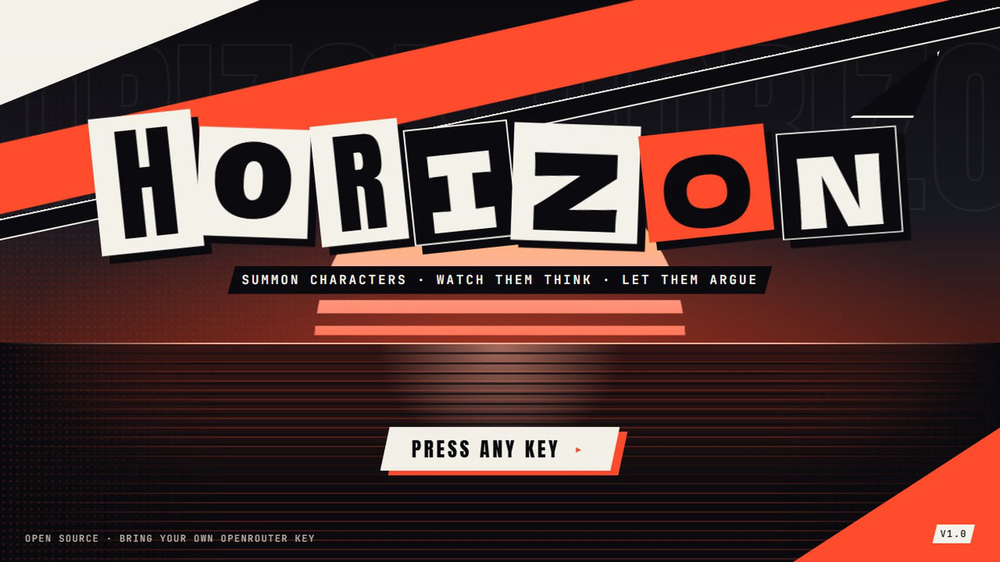
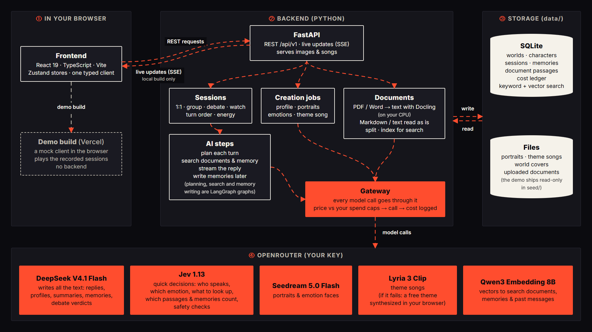

# Horizon



Horizon is an open-source app where you create AI characters, then talk to them, put them in a room together, have them debate each other, or watch them play out a scene on their own.

**Live demo:** <https://horizon-seven-mauve.vercel.app> (desktop browser, 1280 × 720 or larger). It plays recorded sessions on a mock client: no install, no key. Press <kbd>?</kbd> in the app for the keyboard shortcuts.

## What you can do

- **Create a character from one line.** Horizon drafts the profile, paints a portrait, six emotions and a blink from the face you lock, and composes a theme song. Every paid step shows its price first; a whole character costs about $0.20.
- **Four ways to talk:** 1:1 chat, a group that answers and reacts to each other, a debate with a host, rounds and a verdict, and Watch mode, where they play out a scene without you.
- **Memory:** when a session pauses, each character keeps what mattered in long-term memory.
- **Documents:** give a character PDFs, Word, Markdown or text, and it cites the passages it uses.
- **See inside:** the Insight drawer (<kbd>I</kbd>) shows who was picked to speak and why, what was recalled, the context budget and the cost of every turn.

## How it works



Everything runs on your machine; only the model calls go out, through OpenRouter with your own key. DeepSeek writes the text and TypeSafe's Jev model makes the quick decisions. [docs/README.md](docs/README.md) maps the designs behind each part.

## Run it locally

**You need:** Node.js **24** (pinned in [`.nvmrc`](.nvmrc)) and [uv](https://docs.astral.sh/uv/), which installs Python 3.12 for the backend by itself. No Docker, database server or GPU.

| | Windows (PowerShell) | macOS / Linux |
|---|---|---|
| Node.js 24 | `winget install OpenJS.NodeJS.LTS` | your package manager, [nvm](https://github.com/nvm-sh/nvm) or [nodejs.org](https://nodejs.org) |
| uv | `winget install --id=astral-sh.uv -e` | `curl -LsSf https://astral.sh/uv/install.sh \| sh` |

```bash
git clone https://github.com/weihang369/Horizon.git
cd Horizon
npm run setup      # npm installs (root + frontend) and uv sync for backend/
npm run dev        # the backend on http://127.0.0.1:8000 and the app on http://localhost:5173
```

Open <http://localhost:5173>: the two demo worlds load in demo mode. Ctrl-C stops both servers. Your data stays in `data/` at the repo root (git-ignored).

- **Your OpenRouter key (optional).** Live chat and creation need a key from [openrouter.ai/keys](https://openrouter.ai/keys). Paste it in **Settings → Connection** (stored in `data/secrets.local.json`), or set `OPENROUTER_API_KEY` in `.env`. Without a key, everything recorded still plays.
- **Windows: keep the folder path short.** Generated images are saved about 140 characters below the repo folder, and
  Windows stops at 260 unless long paths are on. A clone in a deep folder (a path over about 120 characters) can't save
  them; clone to a short path such as `C:\Horizon`, or turn on Windows long paths. The backend warns at start-up.
- **Ports already in use?** Copy `.env.example` to `.env` and change `HORIZON_PORT` (the backend, default 8000) or `HORIZON_WEB_PORT` (the page, default 5173). Both servers read them from that one file.
- **PDF and Word documents (optional).** Markdown and text work straight away. PDF and DOCX need Docling on CPU PyTorch and its models, about 1.4 GB, downloaded once: `npm run setup:docling`, then `uv run --project backend horizon models fetch`.
- **Reset:** Settings → Data → "Reset demo data" restores the demo and keeps your own worlds.

Developer commands, tests and the rest of the setup are in [CONTRIBUTING.md](CONTRIBUTING.md).

## Privacy

Horizon runs on your machine; what leaves it goes through your own OpenRouter key:

- **Chat** (replies, summaries, drafts, verdicts, memory writing) goes through OpenRouter to **DeepSeek**, or, if it is
  unavailable, another full-precision provider (`allow_fallbacks`). Requests are routed with data collection
  **allowed** (D-80), which DeepSeek's own endpoint needs: these providers may use what they receive for training,
  including your messages, passages from your documents that a character uses, and memories.
- **Jev** (TypeSafe, through OpenRouter) answers Horizon's yes/no and choice questions: who speaks, a face, whether a
  document is needed, and the safety checks. It reads short excerpts of the conversation.
- **Embeddings:** each document you add is sent once to the embedding provider (Nebius) to be indexed, and each
  message you search with is embedded too.
- **Images and music:** portrait and expression prompts go to the image model, and a song brief to the music model.
- **Everything else stays in `data/`** on your machine (NFR-13): sessions, memories, documents, the cost ledger and
  your key. The backend listens on `127.0.0.1` only, and the key never appears in logs, errors, exports or the ledger.

The app says this under the key field in Settings → Connection and in each character's Knowledge drop zone. To keep
your text away from providers that train on it, set `data.gateway.routing.data_collection` to `"deny"` in
`seed/pricing.json` and restart the backend; requests then go to third-party hosts, which may be slower or cost more.
Two developer switches that change what is kept or sent are off by default; see
[CONTRIBUTING.md](CONTRIBUTING.md#developer-switches).

## Credits

The look is inspired by Persona 5: ransom-note titles, slanted panels, red and black everywhere. Big respect to Atlus's UI team. Every shipped asset's source is listed in [ASSETS.md](ASSETS.md).

## Contributing, security and license

- [CONTRIBUTING.md](CONTRIBUTING.md): setup, the checks before a pull request, and how changes are made.
- [SECURITY.md](SECURITY.md): report security problems privately.
- Ideas left out of v1 are in [docs/v2/](docs/v2/README.md).

[MIT](LICENSE) © 2026 Tan Wei Hang
