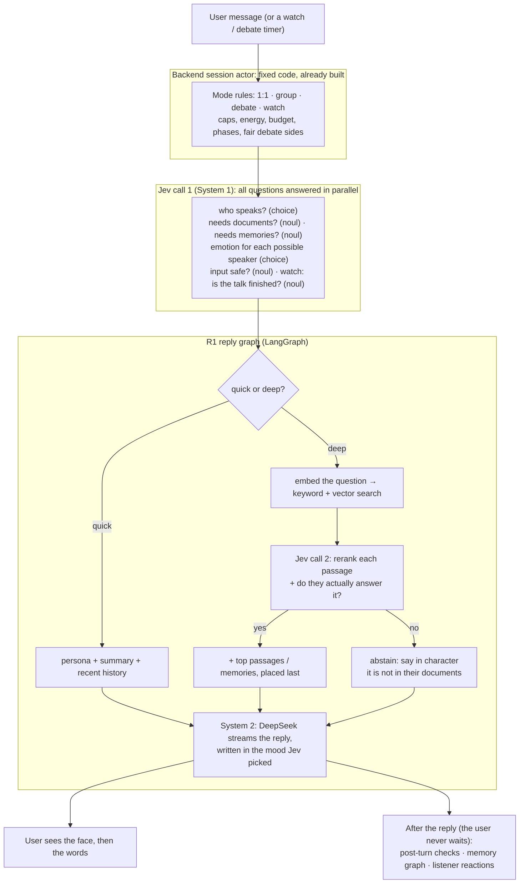
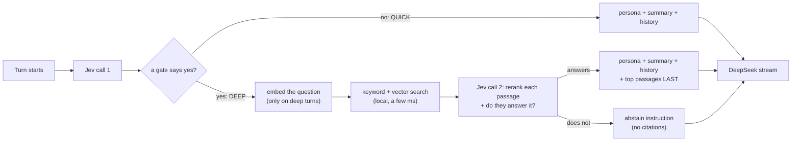

# 01: Agent architecture (where LangGraph lives)

> **Status: agreed with the user, 2026-10-09** (AI stage, task 1 of 13). It resolves OQ-AI-04 and feeds OQ-AI-03, 06, 07,
> 12 and 17. The decisions are numbered **A1–A13**, each with the alternatives we rejected. The checks in §7 run before
> implementation, and the changes in §8 are approved one by one when their task comes up.

## 1. The question

The stakeholder fixed LangGraph as the framework. The open question is **which parts of Horizon are LangGraph graphs,
which are Jev calls, and which stay ordinary code**. Every later task (memory, RAG, debate, emotion) builds on this.

**Horizon's headline goals are speed and cost.** That is why it uses Jev and Chinese models. The user's rules:
- **Speed:** a human must *feel* it is fast, and we don't micro-optimise. The bar is the existing requirements:
  - **NFR-01:** in 1:1 the first word appears within **2 s typically (p50)** and **4 s for the slowest 10 % (p90)**;
  - **NFR-02:** the next speaker's first word within **3 s (p50)**;
  - **NFR-29:** the face never lags the words.
- **Cost:** keep it low, but **System 1 (Jev) is the app's focus**. Several Jev calls per turn are fine, even if Jev
  costs more than DeepSeek in total. Save money where it costs no quality: for example, **embed the question only when
  a turn goes deep**.

## 2. What Horizon already has

From the code, not from plans:

- **The backend already runs every mode as fixed code** (`backend/horizon/sessions/modes/`):
  - debate runs its phases in order and alternates the sides (members follow cast order);
  - watch takes turns round-robin with a turn cap;
  - group mode picks up to two speakers.

  It is ported from the mock UI, and the parity tests keep the two identical.
- **Every AI step sits behind a port**: reply, router, reactions, host, verdict, summary, guardrail, memory writer,
  retrieval, drafter, image, song.
- **A reply today is one DeepSeek streaming call.** Retrieval runs *before* the reply, in the runtime (D-92).
- **Today the query embedding starts as soon as a 1:1 or group message arrives**, in parallel with routing. Debate and
  watch never embed (D-97). This design changes that (A6, §8).
- **The session event log in `horizon.db`** already gives:
  - each session's history;
  - recovery after a crash;
  - pauses for the human (moderator steering, Step in).

## 3. Background: the course notes, applied to Horizon

| Idea (notes *7.1 Agents*, *6 RAG*) | What it means for Horizon |
|---|---|
| **Workflow vs agent (7.1.1):** "most production systems are workflows with agentic steps" | Horizon is a **workflow**: code fixes the structure (who may speak, phases, caps). It has **agentic steps** inside, where Jev or the model decides: who replies, whether to look things up, which emotion, what to remember. |
| **Generative vs agentic (7.1.1):** the main agentic risk is wrong actions on real systems | Characters only talk; they never act on real systems. Heavy agent controls (tool approval, sandboxes) are not needed. |
| **Chain vs graph (7.1.4):** a chain is enough until the flow needs a branch, a loop, parallel steps or a pause | Use a graph only where a flow branches, loops or runs steps in parallel. |
| **Multi-agent (7.1.6):** split into agents only when stages need genuinely different prompts | Each character has its own persona prompt, so Horizon is a genuine multi-agent system. |
| **Supervisor (7.1.6):** the supervisor is a bottleneck and a single point of failure | Our supervisor is the session actor plus **Jev**, not an LLM. Jev is fast, and a fixed rule takes over if it fails or is unsure. |
| **Blackboard/swarm (7.1.6):** cost and termination are hard to bound | Watch mode resembles it, so it keeps hard caps (10/20/40 turns, budget, energy). |
| **Debate pattern (7.1.6, 7.1.11):** agents on one base model converge ("debate collapse") | All characters use DeepSeek, so the defence is strongly different personas (task 8). |
| **Checkpointer (7.1.4):** gives per-thread memory, crash recovery, human pauses | The event log already gives all three. |
| **ReAct / tool calling (7.1.2–7.1.3):** each tool round is another model call | A tool loop adds a model round trip before the first word. |
| **Agentic RAG (6.13), threshold and abstain (6.9):** decide whether and where to look; refuse below a bar | Jev decides before retrieval whether to look, and after retrieval whether the passages really answer the question; if not, the character abstains. |
| **Harness (7.1.9):** "built to be taken apart as models change" | Our ports and AI profiles: swap one implementation without touching the rest. |
| **Frameworks (7.1.7)** | LangGraph: loops, branches, parallel steps. CrewAI: weak dynamic routing. AutoGen: hard to bound and test. |

## 4. The design in one picture

**System 1 decides, System 2 speaks.**
- **System 1 = Jev.** It is fast and cheap, and it only picks from fixed options:
  - **choice:** one of a list;
  - **noul:** yes/no as a probability;
  - **score:** a point on an ordered scale.
- **System 2 = DeepSeek V4.1 Flash.** It writes the words.

"System One" is TypeSafe's own name for Jev's model family. The framing follows Kahneman's fast and slow thinking.

## 5. Decisions

### A1. LangGraph is the only agent framework, for all four modes

**Decision:** 1:1, group, debate and watch all use LangGraph. No CrewAI, AutoGen, Microsoft Agent Framework or Claude
Agent SDK.

**Why:**
- All four modes share the same reply flow (R1, A6). With one framework, R1 is built and tested once.
- **AutoGen's** group chat lets an LLM pick the next speaker, which is exactly the slow, costly step Jev replaces. It is
  also in maintenance mode, and hard to bound and test (7.1.7).
- **CrewAI** has weak dynamic routing (7.1.7), and our routing is dynamic.
- **LangChain** is the chain library LangGraph builds on. We use only small parts of it, never its model classes (A8).
- The **Agent SDK** runs Claude models only.

**Rejected:**
- a different framework per mode, because R1 would be built twice in two state models;
- AutoGen for debate, because of its LLM speaker selection and maintenance mode.

### A2. The backend actor keeps the structure; LangGraph runs the AI steps inside it

**Decision:**
- The backend's fixed code keeps owning modes, phases, turn order rules, caps, energy and saving.
- LangGraph runs the AI pipelines inside each step.
- The public description is "a deterministic workflow with agentic steps".

**Why:** this is the 7.1.1 shape, and it is also TypeSafe's own guidance: "keep control flow, deterministic rules and
side effects in code" and "replace agent loops with software workflows where possible". The mode code is finished,
tested and matched to the mock.

**Speed and cost:** rules such as "the debate side alternates" or "the turn cap is reached" take microseconds and cost
$0.

**Rejected:**
- one LangGraph graph for the whole session, because it rewrites the runtime, duplicates the event log and breaks the
  parity between the mock and the real backend;
- an LLM supervisor, because it is slow and costly, and it is a bottleneck and a single point of failure (7.1.6).

### A3. Every bounded decision goes to System 1 (Jev); DeepSeek only writes words

**Decision:**
- Any decision with a fixed set of answers is a Jev question:
  - who speaks;
  - quick or deep;
  - whether passages really answer the question;
  - the emotion;
  - whether the input is safe;
  - whether the talk is finished;
  - reranking;
  - memory importance;
  - rubric scores.
- DeepSeek is used only where text must be written: replies, host lines, summaries, the verdict prose, profile drafts.
- Every Jev call goes through the `Decider`, with a fallback.
- **Jev may be called several times in one turn**, as long as each call is needed.

**Which Jev type fits which job** (so no part of a Jev answer is wasted):

| Type | Returns | Use for | Examples |
|---|---|---|---|
| **choice** (always with a `none` option) | the pick, a probability per option, a confidence | one of a list of names | who speaks, which emotion, which debate member |
| **noul** | the probability of "yes" | a single yes/no condition | needs documents? needs memories? input safe? talk finished? do the passages answer it? |
| **score** (2–10 ordered levels) | a weighted position, a probability per level, a confidence | a degree on an ordered scale | passage relevance, memory importance, debate rubric |

**Emotion is a choice, not a score:** the 7 emotions are names with no order. **A noul is never used for a degree**;
that is a score's job.

**How every Jev question is written** (from TypeSafe's official guidance and its list of known weak spots):
1. **One condition per question.** Combine answers in code, and never let one answer become hidden context for another.
2. **Phrase a noul so that a high value means yes.** Avoid negations such as "free of…".
3. **Each choice option gets a `what`, a `not_for` and examples**, with the same field names across options.
4. **Choice leans toward the first option** (a known jev-1.13 weak spot). Speaker options are therefore shuffled with a
   seed, so a turn can be replayed exactly.
5. **Keep the state small and relevant.** Accuracy drops as irrelevant content grows. Pass only what a question needs,
   with named fields (e.g. `` `recent[2].text` ``).
6. **No maths, counting or dates for Jev.** Do them in code and pass the results in as labels.
7. **Text written by users or found in documents can try to steer Jev**, so the state marks it as quoted content
   (task 11).

**Speed and cost:**
- Jev input costs $0.042 per million tokens, and output is free.
- TypeSafe says "most queries complete in about 100 ms".

**Rejected:** using DeepSeek structured output for these decisions. It is slower, costs more, and returns no
probabilities for Insight.

### A4. Jev call 1 (System 1): every question about the turn, in parallel

**Decision:** before each reply, the runtime makes **one** Jev call holding every question that depends only on what
has happened so far. TypeSafe calls this **Speculative Fan-Out**: ask everything you might need, and let code use what
applies. One call may hold several questions of the same type (TypeSafe's noul docs show two and three nouls in one
request).

| Mode | Questions in Jev call 1 |
|---|---|
| **1:1** | needs documents? · needs memories? · emotion · input safe? (the speaker is the one character, so no question) |
| **Group** | who replies (≤ 2; an @mention or the Everyone button skips this) · the gates · emotion for each candidate · input safe? |
| **Debate** | the backend picks the **side**, so turns stay fair. If that side has 2+ members, Jev picks **which member** is best placed to answer. Plus the gates and the emotion for each member of that side. |
| **Watch** | who speaks next · is the talk finished? · the gates · emotion for each candidate |

**Rules:**
- **Questions in one call can't see each other's answers.** So the emotion is asked **for every possible speaker**, and
  code keeps the one for whoever was chosen.
- **Confidence floors** apply to every choice and score answer. A noul has no confidence, so its probability is used
  directly. The numbers are tuned on labelled data in task 2 (TypeSafe: "set thresholds by the cost of error").

**What happens when Jev fails, is late, or is unsure:**

| Question | Jev failed or late | Jev unsure (below the floor) |
|---|---|---|
| who speaks / which member | @mention, else round-robin (today's rule) | @mention, else whoever spoke **least recently among Jev's top 2** |
| needs documents / memories | yes, so retrieval runs anyway | treat as yes |
| emotion | DeepSeek's inline `<e:label>` tag (the naive path, already built) | **keep the previous face**; DeepSeek is told the previous mood |
| input safe | pass, with a flag in Insight | task 11 decides |
| talk finished | no (the turn caps still bound watch mode) | no |

Every fallback is marked in the trace and shown in Insight.

**Speed and cost:** one round trip covers every question; adding a question adds tokens, not time.

**Rejected:**
- one Jev call per question, because they would run one after another;
- skipping Jev call 1 in 1:1 chat, because then the face shows late and every turn pays for retrieval.

### A5. AUTO emotion: Jev first, DeepSeek follows

**Decision:**
- In AUTO mode, the emotion comes from Jev call 1.
- The face changes **before** the first word.
- DeepSeek is told the mood and writes to match it.
- If Jev is unsure, the previous face stays (A4).
- MANUAL emotion stays face-only and never changes the reply.
- Task 6 confirms this with the evaluation and words the mood instruction.

**Why:** NFR-29 (the face never lags the words) is met by design, and the words and the face always agree.

**Rejected:**
- DeepSeek's inline tag as the main source, because the face appears only with the first word;
- Jev reading the reply afterwards, because the face would change after the words.

### A6. R1: a quick reply or a deep reply (the user's design), in all four modes

**Decision:**
- **Quick reply:** persona + rolling summary + recent history → DeepSeek.
- **Deep reply:**
  1. embed the question (**only now**, never before the gate says yes);
  2. keyword + vector search over knowledge and/or memory;
  3. **Jev call 2**, which holds the rerank (a score per passage) **and** the after-check ("do these passages actually
     answer it?"). Both depend only on the candidates, so they share one call;
  4. DeepSeek, with the top passages placed **last**, which keeps the cached prefix intact.
- **Abstain.** If Jev call 2 says the passages don't answer it, the character says, in character, that it isn't in
  their documents, and no citation is shown. (6.9: "refuse below a tuned threshold"; 6.14: "weak matches presented as
  answers" is a common trap.)
- **Memory and knowledge have separate gates.**
  - Knowledge is the conservative one: a stricter threshold, the after-check, and it always cites.
  - Memory doesn't cite.
  - The thresholds are set in tasks 9 and 10.
- **All four modes may go deep.** Jev decides per turn. The question to search with is:
  - 1:1 and group: the user's message;
  - debate: the motion plus the last opposing argument;
  - watch: the last message.

  The exact wording is set in tasks 5 and 10.

**Speed and cost (estimates; check 3 in §7 measures them):**

| Turn | Steps before the first word | Estimate |
|---|---|---|
| Quick | Jev call 1 → DeepSeek first token | ≈ 0.6–1.5 s |
| Deep | Jev call 1 → embedding → search → Jev call 2 → DeepSeek first token | ≈ 1.0–2.5 s |

- Both should stay within NFR-01 (2 s p50, 4 s p90).
- The face shows right after Jev call 1, before any words.
- Embedding only on deep turns adds about 0.2–0.4 s to those turns, and saves the embedding cost on every quick turn.

**Rejected:**
- always deep, which costs more and is slower on small talk;
- always quick, which means no citations and no memory;
- embedding every message in parallel (today's D-97), which pays for the embedding on small talk;
- a dedicated reranker model, which the user dropped for Jev;
- a gate only before retrieval, because a weak match could still be cited.

### A7. When something is a LangGraph graph

**Decision:**
- **Two or more steps that branch, loop or run in parallel → a LangGraph graph.**
- **One call → a plain port call** (gateway or `Decider`).

| LangGraph graphs | Plain calls (one step) |
|---|---|
| **R1 reply graph** (A6): gate branch → embed → search → Jev call 2 → stream | **Jev call 1** (A4) |
| **Post-turn check graph**: emotion check ∥ citation check ∥ output guardrail → merge into Insight | **Listener reactions** (one Jev call) |
| **Memory graph** (task 9): extract → Jev importance → compare with old memories → insert / supersede / reinforce / skip | **Rolling summary** (one DeepSeek call) |
| **Verdict graph** (task 8): Jev rubric scores in parallel → host writes the verdict | **Profile drafter, image, song** |

**Rejected:**
- wrapping every call in a graph, which is ceremony;
- plain code everywhere, which loses the uniform tracing and the Insight graph view, and isn't the stack the
  stakeholder fixed.

### A8. Every model call goes through our gateway

**Decision:**
- Graph nodes call the same gateway as today.
- We add only the `langgraph` package; LangChain model classes such as `ChatOpenAI` are not used.

**Why:** the gateway owns the ledger, budget caps, energy, reservations and key safety.

**Speed and cost:**
- it keeps DeepSeek's cache-friendly prompt layout (NFR-35), with the fixed persona prefix first;
- cached input costs $0.003 per million tokens, against $0.15 uncached.

**Rejected:** LangChain model classes pointed at OpenRouter, because they skip the ledger, the caps and energy.

### A9. No checkpointer: graphs keep no state between runs

**Decision:**
- Each run starts from the frozen `TurnContext` and returns events.
- `data/graph.db` stays reserved. Task 9 decides whether the memory consolidation job needs it.

**Why:**
- the event log already gives what a checkpointer gives (7.1.4);
- "Forget means gone" stays automatically true;
- the evaluation harness (task 2) can replay any turn from JSON.

**Rejected:** a checkpointer on every graph, because the state would be stored twice, there would be disk writes after
every node, and Forget would get harder.

### A10. No tool-calling loop on the reply path, and no MCP

**Decision:**
- Characters don't call tools while replying. Jev decides before the reply (A4, A6).
- No MCP servers: Horizon has no outside tools to connect.

**Why:**
- a tool loop adds a whole extra DeepSeek round trip before the first word, and re-sends the prompt each time;
- a tool call is one more way to fail (7.1.11).

**Rejected:** ReAct with a `search_knowledge` tool.

### A11. Streaming and Stop

**Decision:**
- Graph nodes send reply events through LangGraph's custom stream writer, and the engine passes them straight on.
- On Stop, the actor cancels the run, and the DeepSeek stream closes, within NFR-20's 500 ms.
- A cancelled run starts no more nodes. That's why the checks are a **separate** post-turn graph: they still run on an
  interrupted reply.

### A12. A new AI profile `agent`, and Jev's decisions shown in Insight

**Decision:**
- `HORIZON_AI_PROFILE = scripted | naive | agent`.
- `agent` becomes the default when a key is set, only after it beats `naive` in the task 2 evaluation on quality,
  speed and cost.
- `naive` stays as the baseline.
- Each graph node adds its name to `trace.graph.path`, which gives the Insight graph view (INS-03).
- LangSmith, when switched on, sees every graph run (task 2).
- **A "System 1" section in Insight** shows every Jev question of the turn with its answer and probability:
  - the gates (quick or deep, the after-check, abstain);
  - the speaker;
  - the emotion candidates;
  - the safety check;
  - every fallback.

  This is a **contract change** (a new `TurnTrace` section and UI), so it gets the user's separate approval before it
  is built (§8).

### A13. Parallel where it is free; nothing before the first word unless it is needed

**Decision:**
- The questions inside each Jev call run in parallel.
- The checks, memory writing, listener reactions and the rolling summary all run **after** the reply finishes
  streaming.
- Deep-only work (the embedding, the search, Jev call 2) runs only when Jev call 1 says deep. A little speed is traded
  for not paying on quick turns.

## 6. Failure modes (7.1.11) checked against this design

| Failure | Status |
|---|---|
| Infinite loop, cost explosion | **Covered** by the software stage: turn caps, daily budget cap, energy, reservations |
| Race conditions | **Covered**: one actor per session is the single writer |
| Invented tool names, wrong argument types, parse failures | **Not applicable**: no tool loop (A10). Jev answers are typed, so they can't be malformed. Drafter and verdict JSON uses structured output (task 3). |
| Prompt injection via retrieved text or user text | **Tasks 10 and 11**: treated as quoted content in the Jev state and the prompt, never as instructions |
| Weak matches presented as answers | **Covered** by the after-check and abstain (A6) |
| Debate collapse | **Task 8** |
| Lost in the middle | **Task 5**, plus few, strongly reranked passages (A6) |
| Jev outage, slowness or uncertainty | **Covered** by the fallbacks and confidence floors (A4) |
| Choice bias toward the first option | **Covered** by the seeded option shuffle (A3 rule 4) |

## 7. Checks before this is locked

Checks 1 and 2 cost $0 and use the scripted gateway on Windows. **Checks 3 and 4 make real calls costing well under
$0.05 in total, and need the user's approval before they run.**

| # | Check | Pass mark | If it fails |
|---|---|---|---|
| 1 | LangGraph overhead before the first token | not noticeable (< 50 ms) | The R1 graph goes back to plain code; only the off-path graphs use LangGraph |
| 2 | Stop closes the DeepSeek stream, with nothing left running | no leaked task or connection; within NFR-20's 500 ms | Fix the cancellation path before building on it |
| 3 | Real quick and deep turns from Malaysia, 30 of each: time to the face and to the first word | first word within NFR-01 (2 s p50, 4 s p90) | Trim the deep path (e.g. merge the gate into fewer questions, smaller state) |
| 4 | Does a multi-question Jev call bill the state once or per question? Compare `usage.cost` for 1 vs 8 questions | — (cost is accepted either way) | Needed only to make the cost estimates shown before spending (NFR-08) correct |

## 8. Changes this design needs (each approved separately, at its task)

| Change | Kind | Why | Task |
|---|---|---|---|
| The runtime asks **Jev call 1** (speaker + gates + emotions + safety) instead of the router alone | backend | A4 | 5–7 |
| **Embed only on deep turns**, replacing D-97's embedding at send; debate and watch turns may embed too | backend | A6 | 10 |
| Debate asks Jev **which member** of the side speaks (today: cast order, `forcedBy: "round_order"`) | backend | A4 | 8 |
| `DebateHost.narration()` returns a fixed string, so it can't stream LLM-voiced host prose | backend | A7 | 8 |
| `WatchDirector` only returns a speaking order, so it can't report "the talk is finished" | backend | A4 | 7 |
| The reply engine receives the Jev emotion and writes in that mood | backend | A5 | 6 |
| **A "System 1" section in `TurnTrace`, and its Insight UI** | **contract + UI** | A12 | 2 / 6 |

## 9. Left for later tasks

- Long-term memory policy: remember everything, or keep only what Jev scores as important (task 9).
- Gate thresholds and confidence floors, tuned on labelled data (tasks 2, 9, 10).
- The mood-instruction wording, and AUTO emotion confirmed by the evaluation (task 6).
- Exactly which fields go into the state for Jev call 1, and the token budget (task 5).
- The rerank and after-check questions: score levels, k, and how the abstain line is worded (task 10).
- What "input not safe" does (task 11).

## Sources

- Course notes: *7.1 Agents* (7.1.1–7.1.11) and *6 RAG* (6.9–6.14), supplied by the user (kept in `private/notes/`).
- TypeSafe docs: [noul (several nouls in one request)](https://docs.typesafe.ai/primitives/noul.md) ·
  [Speculative Fan-Out](https://docs.typesafe.ai/patterns/fan-out.md) ·
  [Confidence-gated routing](https://docs.typesafe.ai/patterns/confidence-routing.md) ·
  [Building with System One](https://docs.typesafe.ai/concepts/how-to-build-with-system-one.md) ·
  [jev-1.13 known weak spots](https://docs.typesafe.ai/model-jaggedness/jev-1.13.md) ·
  [Models and limits](https://docs.typesafe.ai/models.md) · [API](https://docs.typesafe.ai/api.md)
- [OpenRouter: Jev guide](https://openrouter.ai/docs/guides/community/jev)
- [LangGraph streaming](https://docs.langchain.com/oss/python/langgraph/streaming) ·
  [LangChain forum: a cancelled run starts no more steps](https://forum.langchain.com/t/stategraph-does-not-continue-state-transitions-after-task-cancellation/2678)
