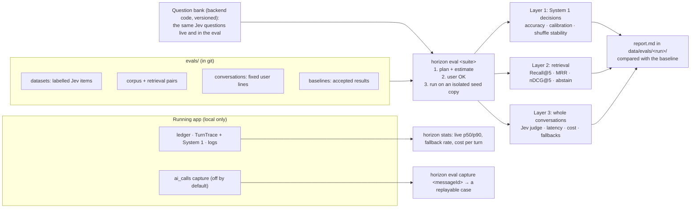

# 02: Evaluation and observability

> **Status: agreed with the user, 2026-10-09** (AI stage, task 2 of 13). It resolves OQ-AI-15 and the evaluation half
> of OQ-AI-08 (task 11 owns the safety half), and it settles two deferred items in doc 05-ai-seams §6: the `ai_calls`
> table and the evaluation harness.
> - Decisions are numbered **B1–B11**, each with the alternatives we rejected.
> - It builds on [01-agent-architecture](01-agent-architecture.md) (A1–A14). "Jev call 1", "Jev call 2", the `agent`
>   profile and the System 1 section in Insight are defined there.

## 1. The question

Doc 01 makes the `agent` profile the default and leaves many numbers open:
- the confidence floors;
- the gate thresholds;
- how many passages Jev call 2 scores;
- whether the face shows inside NFR-29.

Every later task tunes something. This task decides two things:
1. **How we measure Horizon's AI**, so that tuning means "the number went up" and not "it felt better".
2. **How we see what the running app's AI did**, both while developing it and for the user in Insight, without
   breaking NFR-13 ("no telemetry").

**The user's decisions:**
- **"We will use Jev no matter what."** The `agent` profile is the default by the user's decision. The evaluation
  **tunes** it and never decides whether to keep it. `naive` stays as the yardstick that shows how much the design
  improves (A12).
- **No human blind check.** Judging is done by Jev (B4).
- **I draft every label; the user reviews about 1 in 5** (B2).
- **LangSmith is supported, but off by default** (B10).
- **Every real (paid) evaluation run is shown with its estimate and needs the user's OK first** (B6). This is the
  standing rule for paid calls, applied to evaluation.

## 2. What Horizon already has

From the code:

- **The spend ledger** (`usage_records`) records every paid call: purpose, model, tokens in, cached and out, cost,
  latency, and the session, character and message it belongs to.
- **`TurnTrace`** (the `turn_traces` table, shown in the Insight drawer) holds, per reply:
  - the model and its first-token and total latency;
  - the emotion and its candidates;
  - the routing candidates;
  - the recalled memory and the retrieved knowledge;
  - the context budget and cache-hit %;
  - the guardrail checks;
  - `graph.path`;
  - `calls[]`: every paid call behind the turn, with any fallback.
- **Structured JSON logs** (`data/logs/horizon.log`, rotating) carry `request_id`, `session_id` and `message_id`. The
  OpenRouter key is redacted everywhere (NFR-12).
- **`gateway.on_call`** is a no-op hook called after every recorded call. It receives a **redacted summary with
  metadata only** (kind, model, purpose, question ids). It does not receive the prompt or the answer, so the
  `ai_calls` store needs the hook extended (B9).
- **Ports take frozen, JSON-serialisable contexts** (`TurnContext`, `SessionContext`). The turn plan is frozen into
  the `TurnContext` (A6, D-92), so a harness can **replay any turn from JSON**, with exactly the passages and plan it
  saw.
- **`HORIZON_DATA_DIR`** points the whole backend (database, logs, files) at another folder. The harness uses it to run
  on an isolated copy of the seed (B6).
- **CI** runs `ruff`, `mypy`, `pytest` (the `live` and `docling` markers are excluded) and the frontend tests. It uses
  no secrets and makes no paid calls.
- **The seed data is small:**
  - two worlds, Meridian Council and Sunny Hollow, with 6 characters;
  - **37 knowledge chunks** in total: Amara 16, Mei 10, Victor 6, Hana 5;
  - **5 memories**;
  - 5 seed sessions, at least one per mode.

  Retrieval scores on a corpus this small mean nothing: with 5 chunks, "the top 5" is every chunk Hana has. B2 fixes
  this.

## 3. Background: the course notes, applied

| Idea (notes *6 RAG*, *7.1 Agents*) | What it means for Horizon |
|---|---|
| **Measure the parts before the whole (6, evaluation):** retrieval metrics (Recall@k, MRR, nDCG) are separate from answer metrics (faithfulness, answer relevance) | Three layers (B1): System 1 decisions, retrieval, then whole conversations. A bad conversation score can then be traced to the layer that caused it. |
| **RAGAS metric definitions:** faithfulness, answer relevance, context precision and recall | We use the **definitions**, measured with Jev questions (B4). We don't use the `ragas` library, because it makes its own LLM calls outside our gateway (A8). |
| **LLM-as-judge needs checking against labels** | The Jev judge is itself checked against labelled examples before we trust it (B4). |
| **Thresholds and abstaining (6.9):** refuse below a tuned threshold | The confidence floors and gate thresholds are tuned on labelled data, with each one set by the cost of a wrong answer (B5). |
| **Harness (7.1.9):** built to be taken apart as models change | The harness drives the **ports** directly, so it measures any profile (`scripted`, `naive`, `agent`) and any future model swap. |
| **Observability (7.1.10):** trace every step of an agent | Every call is already in the ledger and in `TurnTrace.calls[]`. The System 1 section (A12) shows every Jev question. The `ai_calls` capture (B9) keeps the full prompts when debugging. |

## 4. The design in one picture

## 5. Decisions

### B1. Three layers of evaluation, plus latency and cost on every run

**Decision:**

| Layer | What it measures | How |
|---|---|---|
| **1. System 1 decisions** | Each Jev question on its own: who speaks, needs documents, needs memories, emotion, input safe, talk finished, debate member, passage score, and later memory importance and the rubric | Labelled items → **accuracy**, a **calibration table** (how often Jev is right at each confidence level), and **shuffle stability** (the same item asked with two option orders) |
| **2. Retrieval** | The deep path without the reply: keyword, vector, RRF, then Jev call 2 | Labelled question → passage pairs → **Recall@5, MRR, nDCG@5** for each stage, plus **abstain accuracy** on questions the documents can't answer |
| **3. Whole conversations** | Real multi-turn sessions in all four modes, with `agent` and `naive` | Fixed user lines → the Jev judge (B4), **latency** (time to the face and to the first word, p50 and p90), **cost per turn**, **fallback rate**, how often turns go deep, and how often they abstain |

- **Latency and cost are reported on every layer that makes calls**, because speed and cost are the headline. This is
  how task 1's check 3 runs: `horizon eval latency` is layer 3 cut down to 30 quick and 30 deep 1:1 turns.
- **Every number is reported with its sample size and a 95 % interval** (Wilson for rates). With 40 items, an 80 %
  accuracy is really "somewhere between about 65 % and 90 %". A change smaller than the interval is reported as noise,
  not as a win.

**Why:** a bad conversation score alone doesn't say what to fix. Layers 1 and 2 tell us whether the fault lies in a
decision, in retrieval or in the writing.

**Rejected:**
- **only whole conversations:** cheaper to set up, but a failure can't be traced to its cause;
- **only unit-level Jev tests:** they never show whether the user's experience improved, or what it costs.

### B2. Test data: the seed worlds, plus a small public-domain corpus for retrieval

**Decision:**
- **Everything is built on the two seed worlds and their 6 characters**, the same ones the demo shows. No synthetic
  users: every conversation has **fixed user lines**, so `agent` and `naive` face exactly the same inputs. The
  characters' replies still differ, so later turns differ; the judge scores each reply in its own context.
- **Sizes:**

  | Set | Size |
  |---|---|
  | Layer 1, per Jev question | **~40 items**; **~100** for the three that set thresholds: needs documents, passage score, who speaks |
  | Layer 2, retrieval | **50 answerable** question → passage pairs, and **15 unanswerable** questions on the same topics (the hard negatives for abstain) |
  | Layer 3, conversations | **20**, each 8–12 turns, across both worlds: 1:1 × 6, group × 5, debate × 4, watch × 5 |
  | Judge check (B4) | **30** replies with labelled scores |

- **A retrieval corpus for evaluation only.** The seed knowledge (37 chunks) is far too small to rank, so the retrieval
  suite adds **3–5 public-domain documents** to each seed character that has knowledge, **only in the evaluation's
  isolated copy**. The demo and the user's data never see them.
  - The documents are **US federal government works, which are public domain** (for example NIOSH material on shift
    fatigue for Amara, OPM guidance on alternative work schedules for Mei, the Federal Rules of Evidence for Victor,
    and USDA recipes for Hana).
  - They are stored as extracted Markdown under `evals/corpus/`, about 1 MB in total, with
    `evals/corpus/SOURCES.md` giving each file's source URL and licence.
  - They are ingested through the normal text path, so the real chunker (task 10) is what gets measured.
- **Labels:**
  - I draft every label. Emotion items get **one or two acceptable emotions**, because emotion is subjective.
  - The user reviews **about 1 in 5**, spread across every set.
  - If the user disagrees with more than 1 in 10 of the reviewed labels in a set, I relabel the whole set.
- **Where it lives:** `evals/datasets/*.jsonl`, `evals/conversations/*.yaml`, `evals/corpus/`. All of it is in git,
  and none of it is user data.

**Rejected:**
- **simulated users (an LLM playing the user):** the two profiles would see different inputs, so the comparison is
  noisy, and it doubles the DeepSeek cost;
- **ranking on the seed knowledge alone:** with 5 or 6 chunks per source, Recall@5 is trivially 100 %;
- **LLM-written documents as the corpus:** the labels would be checked against text the same kind of model wrote;
- **web articles or books still in copyright:** the repo is MIT and public.

### B3. One question bank, used live and in the evaluation

**Decision:**
- Every Jev question is defined **once**, in a versioned question bank in the backend (`horizon/ai/questions/`). Each
  definition holds:
  - an id and a version;
  - the type (choice, noul or score);
  - the wording;
  - for a choice: the options, each with `what`, `not_for` and examples;
  - for a score: the levels;
  - what `none` means;
  - the `Decider` purpose and timeout;
  - the fallback;
  - the confidence floor or threshold (B5).
- The live `Decider` and the evaluation both build their requests from the bank, so **the evaluation measures exactly
  what runs in the app**.
- **Any change to a question's wording, options or levels bumps its version.** Evaluation results and the System 1
  section record each question's id and version, so a result never gets compared across different wordings.
- The bank follows doc 01's rules for writing questions (A3):
  - one condition per question;
  - a noul whose high value means yes;
  - options shuffled with the per-turn seed;
  - small, relevant state;
  - no maths or dates for Jev.

**Rejected:** wording kept inside each port's code. The tests would drift away from what runs live, and nothing would
record which wording produced which result.

### B4. Judges: Jev only, and the judge is checked first

**Decision:**
- **No human blind check** (the user's decision). **Jev is the only judge**, through questions in the same bank:

  | Metric | Jev question |
  |---|---|
  | **Stays in character** | score, 5 levels, state = the persona card + the last few turns + the reply; each level has a written description |
  | **Agent vs naive** | **pairwise choice**: "reply A", "reply B", "about the same". Asked **in both orders**; it counts as a win only if both orders agree, otherwise it is a tie. This cancels choice's lean toward the first option. |
  | **Answers the message** (answer relevance) | score, 4 levels |
  | **Faithfulness** | noul for each cited passage: "does this passage support what the reply says it supports?". This is the same question as the live post-turn citation check (A7, TypeSafe's `citation_check` cookbook). |
  | **Face and words agree** | choice from the 7 emotions, given only the reply text, compared with the face that was shown. This is the same question as the live post-turn emotion check. |
  | **Debate quality** | the rubric scores, defined in task 8 |
  | **Safety** | a red-team set, defined in task 11 |

- **The judge is checked before we trust it.** For "stays in character" and "answers the message", I label 30 replies
  and the user reviews about 1 in 5 of them. The judge must agree with the labels **within one level on at least 80 %
  of them**. If it doesn't, the question's wording is fixed and checked again, the same way any Jev question is tuned.
- **Every judge question is evaluated in layer 1 too,** like any other Jev question.

**Speed and cost:** a judge request is about 1–2 k tokens, roughly $0.00006. Judging a full conversation run costs a
few cents.

**Rejected:**
- **DeepSeek as the judge:** it writes the replies, so it would be judging its own writing (self-preference). It is also
  slower and costs more, and it gives no probabilities;
- **a stronger outside model as the judge:** it costs more, and it goes against the System 1 focus;
- **the `ragas` library:** it makes its own LLM calls, outside the gateway, the ledger and the caps (A8).

### B5. How the confidence floors and gate thresholds are set

**Decision:**
- **Each threshold is set by the cost of acting on a wrong answer** (TypeSafe's confidence-routing pattern). These are
  starting targets, re-tuned as the data grows:

  | Question | Which mistake hurts | Starting target |
  |---|---|---|
  | who speaks | a slightly odd speaker; mild | **≥ 80 %** right above the floor |
  | debate member | same as above | **≥ 80 %** |
  | emotion | a wrong face; visible but mild | **≥ 80 %** inside the acceptable set |
  | needs documents | a missed lookup means no citation and a guessed answer; an extra lookup costs time, and Jev call 2 then drops weak passages | **recall ≥ 90 %** on the items that need documents |
  | needs memories | the same trade-off, and milder | **recall ≥ 85 %** |
  | knowledge abstain (Jev call 2) | saying "not in my documents" when it is there is very visible | **≤ 5 %** wrong abstains on answerable questions, **≥ 80 %** abstains on unanswerable ones |
  | talk finished | ending a watch early | **precision ≥ 90 %** |
  | input safe | task 11 | task 11 |

- **Method:**
  - For a **choice or score**, the floor is the lowest confidence at which the answers above it meet the target.
    Below the floor, doc 01's "Jev unsure" fallback applies (A4).
  - For a **noul**, the threshold is the probability that meets the target.
- **If no floor meets the target with at least 70 % of answers still above it,** the question is rewritten. Lowering
  the target is the last resort.
- **The calibration table is kept in the report:** for each confidence band, how many answers and how many were
  right. If a confidence of 0.9 is right only 60 % of the time, Jev is overconfident on that question, and the table
  shows it.
- **Shuffle stability:** every choice item is asked with two option orders. If Jev agrees with itself less than 85 % of
  the time, the question is rewritten, because its answer depends on where the options sit.
- The chosen floors are stored in the question bank (B3), so they are versioned with the wording that produced them.

**Rejected:** one global confidence floor for every question. A wrong speaker and a wrong abstain don't cost the same.

### B6. The `horizon eval` command

**Decision:**
- **One command, `horizon eval <suite>`,** where the suite is `decisions`, `retrieval`, `conversations`, `latency` or
  `all`. Options:
  - `--profile agent | naive | scripted` (`conversations` runs `agent` and `naive` by default);
  - `--limit N` for a quick partial run;
  - `--max-usd` for the hard spend cap;
  - `--yes`.
- **Every real run follows the same steps:**
  1. It prints the plan: what will run, how many calls, and **the estimate** (from the gateway's own estimators, with
     peak-hour pricing applied).
  2. It warns if DeepSeek peak hours are on (R-23). Off-peak costs half.
  3. **It asks before spending.** `--yes` skips the prompt. I use it only after the user has approved that run's
     estimate in chat.
  4. It runs on an **isolated copy of the seed**: a fresh `HORIZON_DATA_DIR` under `data/evals/<run-id>/`. The user's
     worlds, ledger and memories are never touched, and every run starts from the same state.
  5. Every call still goes through the gateway, so it is priced and recorded in the run's own ledger. The run's **daily
     cap is set to `--max-usd`** (default: the estimate × 1.5), so the existing cap stops a runaway run.
  6. It writes `report.md` and `results.jsonl` into the run folder. The report compares the results with the
     **baseline** and flags a change only when it is larger than its interval (B1).
- **Baselines:** when we accept a run, its summary (the numbers, question versions, model ids and date) is saved to
  `evals/baselines/<suite>.json` in git. Raw results stay in `data/`, which is gitignored.
- **Estimated cost of a full run** (`all`, off-peak):

  | Suite | Main calls | Estimate |
  |---|---|---|
  | decisions | ~600 items × 2 orders, ~1 k tokens each, on Jev | ≈ $0.05 |
  | retrieval | corpus embedding once, 65 queries × ~15 Jev passage scores | ≈ $0.03 |
  | conversations | 20 × ~10 turns × 2 profiles ≈ 400 DeepSeek replies, plus Jev planning and judging | ≈ $0.27 |
  | **total** | | **≈ $0.35 (about RM 1.60)**; about $0.50 at DeepSeek peak hours |

  Over the whole stage, with a dozen or so full runs and many partial ones, that comes to about **$3–6**. The command
  computes the real estimate every time, and this table is only a guide.

**Rejected:**
- **running against the user's own database:** the eval would change the user's memories and history, and it couldn't
  be repeated;
- **a separate notebook or script per experiment:** results couldn't be compared over time;
- **runs without asking:** they break the standing rule that every paid call needs approval (and NFR-30's spirit).

### B7. What CI runs: the scripted profile only

**Decision:**
- CI runs `horizon eval all --profile scripted`. It uses the scripted ports and the scripted gateway, makes no network
  calls and costs nothing.
- This checks the harness itself, not the AI: datasets load, the question bank builds valid requests, the metric code
  gives the right numbers on known inputs, and the report renders.
- The metric functions (Recall@k, MRR, nDCG, Wilson intervals, calibration bins) get ordinary unit tests with
  hand-worked answers.
- Real runs happen only on the user's machine, on request.

**Rejected:** real evaluation runs in CI. CI has no secrets (by design), and paid runs need the user's approval.

### B8. Observability in the running app: what already exists, plus a local report

**Decision:**
- **For the user, Insight is the window.** The `TurnTrace` is already there, plus the **System 1 section** from A12.
  That section is a contract change, approved separately (§8 of doc 01).
- **For developing, a new `horizon stats [--days N]` command** reads the user's own `turn_traces` and `usage_records`
  and prints:
  - the time to the face and to the first word (p50 and p90) per mode, against NFR-01, 02 and 29;
  - the quick versus deep rate, and the abstain rate;
  - the fallback rate and timeout rate for each Jev question;
  - Jev's own latency;
  - the cost per turn and the cache-hit %;
  - Jev's share of the spend.
  It runs entirely locally, makes no network calls and needs no contract change.
- **Logs** keep today's shape. The graphs log their node path and any fallback, with `session_id` and `message_id`.

**Why:** most of what a developer needs is already stored, and `horizon stats` turns it into the speed and cost numbers
that are the app's headline, from real use and with no telemetry.

**Rejected:** a metrics dashboard in the UI. It would be a contract and UI change, and Insight already covers a single
turn.

### B9. `ai_calls`: full prompt capture for debugging, off by default

**Decision:**
- **An `ai_calls` table, switched on only by `HORIZON_AI_CAPTURE=1`.** When it is on, it records:
  - **one row per paid call:** purpose, model, the redacted request (messages, or Jev's state and questions), the
    response (the reply text, or Jev's full answer), latency, cost, any fallback, the ledger row id, and the session,
    message, character and world ids;
  - **one row per turn:** the frozen `TurnContext` and the turn plan, so the turn can be replayed exactly.
- **`horizon eval capture <messageId>`** turns a captured turn into a replayable case under `data/evals/cases/`, which
  is gitignored because it may hold the user's own chat. A case built from a seed-world session can be promoted to
  `evals/` by hand.
- **The `on_call` hook is extended** to receive the request and response bodies, and **only when capture is on**, so
  normal use copies nothing extra. Everything still passes through the shared redaction (NFR-12).
- **Keeping it small and private:**
  - rows older than **7 days**, or beyond **20 000** rows, are deleted at start-up and every hour;
  - **deleting a session, character or world deletes its rows,** through the existing purge outbox (`ai_purge_queue`),
    idempotently;
  - **forgetting a memory deletes every `ai_calls` row of that character.** The memory's text may sit inside any later
    prompt, and searching prompts for it would be unreliable. Losing debug capture is harmless; keeping forgotten text
    is not (D-70's spirit);
  - a factory reset deletes the table's contents with everything else;
  - the app logs one line at start-up when capture is on.
- It is local, so it doesn't conflict with NFR-13.

**Rejected:**
- **capture always on:** it stores every prompt, which means a lot of disk and a second copy of the user's private chat
  that Forget has to chase;
- **no capture at all:** a bad live turn could never be replayed or turned into a regression case;
- **writing prompts into the JSON logs:** the logs rotate without regard to Forget, and they would grow large.

### B10. LangSmith opt-in, off by default; nothing else leaves the machine

**Decision:**
- **LangSmith is switched on only by `HORIZON_LANGSMITH=1`** plus the user's own `LANGSMITH_API_KEY`. When on:
  - the graphs' runs are traced;
  - the gateway's calls are wrapped as traced steps, so Jev and DeepSeek calls appear with their inputs and outputs.
- **It is a documented exception to NFR-13,** because it sends chat and document text to LangSmith. The app logs a
  warning at start-up while it is on, and the README says what is sent.
- **A guard against accidental tracing.** Unless `HORIZON_LANGSMITH=1`, the backend sets `LANGSMITH_TRACING=false` (and
  the older `LANGCHAIN_TRACING_V2=false`) at start-up. A tracing variable left over in the user's shell then can't send
  anything. LangGraph pulls in the `langsmith` package through `langchain-core`, so this guard is needed even though
  we never call LangSmith ourselves.
- **The OpenRouter key never reaches LangSmith:** traced inputs are messages and Jev states, never headers, and they
  pass through the shared redaction.

**Rejected:**
- **Langfuse:** self-hosting it needs Docker and Postgres, which breaks NFR-10 (zero-config), and its cloud would be
  another outbound service;
- **OpenTelemetry export:** there is no collector to send to, and it breaks NFR-13;
- **LangSmith on by default:** it breaks NFR-13.

### B11. The `agent` profile is the default; the evaluation tunes it

**Decision:**
- `agent` is the default whenever a key is set (the user's decision, A12). The evaluation never switches it back to
  `naive`.
- **A missed target is fixed in the task that owns it,** never by changing the default:
  - a Jev question is rewritten;
  - a threshold moves;
  - the deep path is trimmed.
- **What we report for agent vs naive on the conversation suite:**
  - the pairwise win, tie and loss rates;
  - the in-character score;
  - faithfulness;
  - latency (p50 and p90);
  - cost per turn.

  This is also the evidence behind the LinkedIn "System 1 decides, System 2 speaks" story.
- **The targets that must hold before v1** are the existing NFRs:
  - NFR-01: the first word within 2 s at p50 and 4 s at p90;
  - NFR-02: the next speaker within 3 s at p50;
  - NFR-29: the face within 800 ms of the first word at p90.

  These are measured from Malaysia. B5's targets are tuning goals.

## 6. Checks before this is locked

| # | Check | Cost | Pass mark | If it fails |
|---|---|---|---|---|
| 1 | Does Jev give the same answer to the same request? Ask 20 items 3 times each. **Run together with doc 01's check 4**, under the same approval. | < $0.01 | — (we measure it) | If answers vary, layer 1 asks each item twice and reports the agreement, and the intervals widen |
| 2 | Licence check of every corpus document before it is committed | $0 | each file is a US federal work, with its URL in `SOURCES.md` | Swap in another public-domain source |
| 3 | The user reviews about 1 in 5 of the drafted labels in each set | $0 | ≤ 1 in 10 disagreements per set | Relabel that set |

## 7. Changes this design needs (each approved separately, at its OpenSpec change)

None of these changes the HTTP contract. The only contract change in evaluation and observability is doc 01's System 1
section.

| Change | Kind | Why |
|---|---|---|
| The **question bank** module, which the `Decider` builds its requests from | backend | B3 |
| **`horizon eval`** (the suites, isolated runs, estimate and ask, `--max-usd` as the run's cap, the report and baselines) and **`horizon eval capture`** | backend CLI | B6, B9 |
| **`horizon stats`** | backend CLI | B8 |
| The **`evals/` folder**: datasets, conversations, corpus with `SOURCES.md`, baselines | repo | B2, B6 |
| **`ai_calls`** table (Alembic migration), retention, purge-outbox handling, and the **`on_call` hook carrying request and response bodies when capture is on** | backend | B9 |
| **LangSmith** switch, start-up guard, and gateway steps wrapped as traced steps when on | backend | B10 |
| A ledger purpose for judge calls (`eval_judge`); they run only inside isolated evaluation runs | backend | B4 |
| CI runs `horizon eval all --profile scripted` | CI | B7 |
| **Docs to amend:** OQ-AI-15 resolved; OQ-AI-08's evaluation half resolved; 05-ai-seams §6 (`ai_calls` and the evaluation harness now designed); an NFR-13 note on the LangSmith exception | docs | all |

**Order:** the question bank and `horizon eval` come **first** among the AI-stage changes. Every later change is tuned
with them.

## 8. Left for later tasks

- The debate rubric and its judge questions (task 8).
- The memory retrieval set and the memory-importance labels (task 9).
- The final embedding model and its dimensions. The retrieval suite here is the comparison test that decides it
  (task 10).
- The red-team set and the input-safe threshold (task 11).
- `seed/pricing.json` sets OpenRouter's `data_collection` to `"allow"`, which lets providers keep prompts. That is a
  privacy question for task 11 or task 13, not an evaluation one.

## Sources

- Course notes: *6 RAG* (evaluation metrics, 6.9 thresholds, 6.14 traps) and *7.1 Agents* (7.1.9 harness, 7.1.10
  observability), in `private/notes/`.
- TypeSafe docs:
  - [Confidence-gated routing](https://docs.typesafe.ai/patterns/confidence-routing.md)
  - [jev-1.13 known weak spots](https://docs.typesafe.ai/model-jaggedness/jev-1.13.md)
  - cookbooks: `citation_check`, `parallel_questions`, `rerank_typesafe`
- [RAGAS metric definitions](https://docs.ragas.io/en/stable/concepts/metrics/)
- [LangSmith: tracing environment variables](https://docs.smith.langchain.com/)
